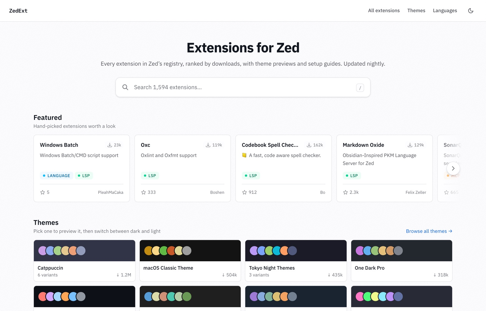

# ZedExt

A fast, modern extension browser for the [Zed editor](https://zed.dev): every extension in Zed's registry, ranked by downloads, with full READMEs, GitHub stats, theme previews and setup guides. Live at [zedext.dev](https://zedext.dev).

<picture>
  <source media="(prefers-color-scheme: dark)" srcset=".github/assets/home-dark.jpg">
  
</picture>

## Why

Zed's official extension page at [zed.dev/extensions](https://zed.dev/extensions) shows only a name, one-line description, and download count. No README, no GitHub stats, no version history, no way to see a theme before installing it. ZedExt fills that gap.

## Features

- **Homepage**: Featured picks, Themes, setup Guides, Recently updated and Languages rows, with a search box that hands off to the full list.
- **Search**: typo-tolerant and instant, running in the browser. Use it from any page with ⌘K or `/`. `/extensions` adds kind filters and sorting.
- **Extension pages**:
  - the full README with syntax highlighting;
  - Zed's docs for language extensions;
  - Version History and Changelog tabs;
  - GitHub stars, license and last commit;
  - Official / Zed org badges.
- **Theme previews**: every theme drawn in a Zed-like window, in dark and light, with sample code in several languages. Icon themes get a file-tree preview. `/themes` lets you browse and compare them.
- **Browse pages**: one page per kind (`/language-servers`, `/mcp-servers`, …), language hubs (`/languages/python`), author pages (`/authors/<github-user>`) and written guides (`/guides/vim`).
- **SEO**: every page is server-rendered with its own meta and Open Graph tags, plus generated OG images, a sitemap and IndexNow pings after each sync.
- **Dark mode**: follows the system, with a manual toggle.

## Architecture

No database and no search service.

```
Cron (00:00 UTC; 12:00 backup) ──► /api/sync
   Zed API + GitHub ──► Vercel Blob
                         ├─ extensions.json        snapshot of the whole registry
                         ├─ history/YYYY-MM-DD.json daily download counts
                         └─ theme-previews.json    colors and icons for every theme

Server (SvelteKit)
   all pages          ──► snapshot (in memory, refreshed every 10 min)
   extension pages    ──► + Zed API (versions) + GitHub (README, stats)
   extension, author  ──► cached with Vercel ISR (refreshed daily, shared by every region)

Browser ──► /extensions.json?v=<snapshot date> on the first search ──► MiniSearch, locally
```

- **Sync:** a daily Vercel cron hits the protected `/api/sync` route. It builds the snapshot from Zed's API plus GitHub stats, records the day's download counts, refreshes the theme previews of themes that changed, and pings IndexNow. A 12:00 UTC backup run only fills in a missing history file.
- **Rendering:** the server renders every page from the snapshot, so pages work without JavaScript. Extension and author pages also fetch from the Zed and GitHub APIs. If GitHub fails they answer 503 rather than cache a page without its README.
- **Search:** the browser fetches the snapshot and the search code only when someone starts searching.

See [`GLOSSARY.md`](GLOSSARY.md) for the domain terms and [`DESIGN.md`](DESIGN.md) for the visual design.

## Stack

- [SvelteKit](https://svelte.dev) (Svelte 5) — framework
- [Tailwind CSS v4](https://tailwindcss.com) — styling
- [MiniSearch](https://github.com/lucaong/minisearch) — search
- [Shiki](https://shiki.style) — syntax highlighting
- [Satori](https://github.com/vercel/satori) + [resvg](https://github.com/yisibl/resvg-js) — OG images
- [Vercel](https://vercel.com) — hosting, cron, Blob storage, ISR and Analytics
- [IBM Plex Sans](https://github.com/IBM/plex) and [Lilex](https://github.com/mishamyrt/Lilex) — Zed's own fonts, from Fontsource
- [Vitest](https://vitest.dev) and [Playwright](https://playwright.dev) — tests

## Getting started

Uses [bun](https://bun.sh).

```sh
# Install dependencies
bun install

# Copy env vars (the production SNAPSHOT_URL works for local dev)
cp .env.example .env

# Start the dev server
bun run dev

# Rebuild the snapshot (requires GITHUB_TOKEN + BLOB_READ_WRITE_TOKEN)
bun run sync
```

## Checks

```sh
bun run test              # unit tests (Vitest)
bun run test:e2e          # browser tests (Playwright, against a dev server on port 4319)
bun run check             # svelte-check
bun run lint              # ESLint
bun run format:check      # Prettier
bun run perf <base-url>   # page weight, Core Web Vitals and cold-page check; fails over budget
```

## Environment variables

```bash
GITHUB_TOKEN=ghp_...                    # GitHub API (server + sync)
SNAPSHOT_URL=https://….public.blob.vercel-storage.com/extensions.json  # Snapshot to read
BLOB_READ_WRITE_TOKEN=vercel_blob_rw_…  # Blob write access (sync only)
CRON_SECRET=replace-with-long-random    # Vercel cron bearer token
PREVIEW_DOWNLOAD_LIMIT=150              # Optional: theme archives the sync downloads per run
```

## Vercel cron

`vercel.json` schedules two runs of `/api/sync`:

- **Daily sync:** `0 0 * * *`.
- **Backup:** `/api/sync?if-history-missing` at `0 12 * * *`. It does nothing if today's download history already exists.

The route checks `Authorization: Bearer $CRON_SECRET`, then runs the same shared sync logic as `bun run sync`, so manual and scheduled syncs stay identical. Notes:

- Both schedules work on the Vercel Hobby plan (free).
- The sync route is a long-running Node function (`maxDuration = 300`).
- You can refresh manually at any time with `bun run sync`, or by calling `/api/sync` with the same bearer token.

## Contributing

Contributions, issues, and feature requests are welcome. See the [issues page](https://github.com/josephsintum/zedext.dev/issues).

## License

MIT
